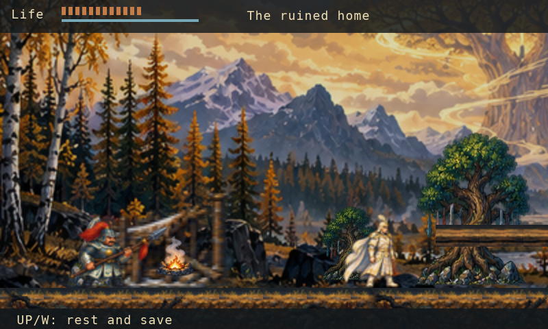
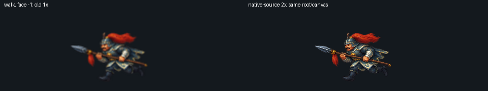
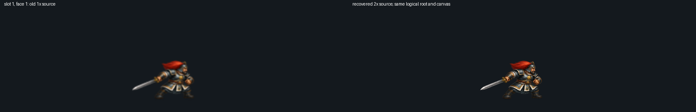

# Nyurgun：Wick で描く世界、人物、物語 { #nyurgun-painted-worlds-characters-and-story-in-wick }

*2026 年 10 月 12 日 · ローカル開発レポート*

Nyurgun は、Wick で制作している、物語を軸にしたサハのアクション探索ゲームです。
移動と戦闘は Castlevania、会話、持ち物、選択は Ultima に着想を得ています。
サハの文学と美術をゲームに生かし、人々、土地、選択によって物語を伝えることを目指しています。
制作の構想は、AI が全面的に制作し、人が作る作品に求める完成度で評価するゲームです。
統一された美術方針、個性ある人物、意味のある動き、丁寧に編集した物語と音を目指します。

物語の典拠は、オロスィン／エルギスの 1947 年版です。ローカルで動作する現在のゲームは、
第 IV〜V 章のアイタリー救出編を 5 地域にわたって描き、原典と照合した第 VI、VII、VIII 章の
エピソードへつなぎます。北への出発もその一部です。これは長い叙事詩の一部分です。
人物には、それぞれの関係や、助ける、抗う、去る理由を持って話し、行動する余地が必要です。

*実際の Wick VM と Lantern のソフトウェアレンダラーを使い、ヘッドレス表示で取得した開発試作です。
ネイティブウィンドウでの検証ではありません。美術は制作途中です。*

## 絵の質感を描画まで保つ { #paint-that-survives-the-renderer }

目標は、選定したヤクートの叙事詩挿絵の画風です。表情のある顔、細かな衣装や金属細工、
奥行きのある風景を求めています。現在のゲームは、まだその水準に達していません。
読みやすくした Unicode 文字、多層の視差スクロール、地域地図、人物の肖像や動作ポーズは、
場面を読み取りやすくし、一人ひとりを描き分けるための取り組みです。

レンダラーは、ゲームの論理座標を 400×240 に保ち、実際の描画密度を
1〜4 に制限しています。ネイティブランチャーの設定は既定で 2、フレームバッファーは 800×480 です。
画素を増やして元の絵の細部を保ちますが、移動や地形の座標は変わりません。

美術データの処理では、明示的な BMP V4 アルファを、従来のマゼンタ色による透過方式と区別します。
アルファで重み付けしたバイリニア補間により柔らかな絵の輪郭を保ち、不透明画素の計算は従来と互換にしています。
書き出し検査では、15 枚のアルファ付きアトラスにある半透明画素 714,269 個を保持しました。

世界樹は、このプロジェクトで生成して保存していた小物の原画に由来します。原画の 224×224 の領域を
そのまま切り出し、余白を加えた 256×256 のアトラス区画へ、従来の 4 倍の密度で格納しました。
原画の細部を正確に保っており、拡大や新たな細部の生成は行っていません。
原画にある薄い縁取りは、今後の見た目の確認項目として残っています。

絵画のアルファを保つレンダラーは、[上流のプルリクエスト #2](https://github.com/alikatgh/lantern/pull/2) を通じて
Lantern の main ソースにマージされました。公開中の Lantern のダウンロードは引き続き 0.8.0 です。

## 人物の細部を取り戻す { #recovering-character-detail }

8 つの肖像区画と 4 つの準備ポーズについて、保存していたプロジェクト生成原画から、
従来の 4 倍のアトラス密度で細部を取り戻しました。人物の同一性、構図、ルートアンカーは保っています。
この改修で新しい美術やアニメーションは追加していません。

*左が従来のアトラス、右が細部を取り戻したものです。どちらも同じ固定ヘッドレス状態から、
実際のゲームの描画処理で 2 フレームを実行し、実際の描画密度 4 で取得しました。
顔や鎧の細部は明瞭になりました。ネイティブ表示と最終的な見た目の品質は未確認です。*

## 統合した候補の確認 { #reviewing-the-integrated-candidate }

新しい **0.4.6 のローカル Mac レビュー候補**は、細部を復元した主人公の32ポーズ、剣と鞭のアトラス、第VI章の負傷・死亡ポーズの優先処理を、復元済みの背景とネイティブ音声ランタイムとともに収録します。変更していないゲームソースは、救出編から第VIII章までを **通常入力11,934フレーム**で完了しました。実際のパッケージから得た8枚の画像で、3言語のタイトルと会話、冒頭、地図を物理密度2で確認しました。独立した成果物レビューは、ソース、画像、署名、アーカイブのバイトと権限を照合しています。以前の候補は変更していません。

これは未公証のローカルレビュー用アーカイブであり、一般公開のゲームリリースではありません。デスクトップ操作への接続は利用できず、0.4.6のネイティブ画面や実機音声の成功は未確認です。VoiceStudio/YuEによる完成音源、最終的な絵と文化面の承認、サハ語話者の確認、叙事詩全体の実装も未完了です。

## 主人公のポーズの細部を取り戻す { #recovering-main-character-poses }

主人公の全 32 ポーズで、元の R4 原画と回転動作の原画から従来の 2 倍のアトラス密度により
細部を取り戻しました。2048×512 のテクスチャでも、論理的な区画、足元の基準点、
フレーム番号と動作の時間は変わりません。すべて原寸以下の縮尺です。
従来の切り取りによる欠落や所有画素の除外は記録したまま保持しています。
原画の細部の復元であり、人体の修正やアニメーションの追加ではありません。

*実際のゲームの描画処理と物理描画密度 2 で、同じ構図を比較しています。
固定ポーズの比較であり、ネイティブ環境でのアニメーション品質を証明するものではありません。*

独立した検査で従来のアトラスを正確に再構成し、各書き出しの RGBA 全 4,194,304 チャンネルを
比較して、取り込み時の 35 件の不正な入力を拒否しました。8 種類のポーズを左右両方向で描画した
16 件を比較し、基準点をずらす対照検査はすべて拒否しました。新たな独立レビューと
主担当による描画の再検査も通りました。
[ソースと美術の更新は main に統合済みです](https://github.com/alikatgh/nyurgun/pull/8)。
保持している 0.4.5 アプリには含まれていません。ネイティブ表示と全体の品質承認は未完了です。

## 剣と聖なる鞭のポーズの細部を取り戻す { #recovering-painted-sword-and-whip-poses }

VI 章の剣と聖なる鞭のポーズで、従来の 2 倍のアトラス密度により細部を取り戻しました。
15 種類の原画から 16 個の 512×192 物理画素の区画を作り、論理的な描画範囲、足元の基準点、
フレーム番号とアニメーションの時間は保っています。古いアトラスを拡大せず、
保存していた生成原画から、原寸以下の縮尺で再構成しました。

*固定状態を実際のゲームの描画処理と物理描画密度 2 で比較した画像です。
細部の復元を示しており、アニメーションの品質承認やネイティブ環境でのプレイ検証ではありません。*

原画の正確な再構成でアトラスの RGBA 全 6,291,456 チャンネルを確認しました。
取り込み時の 21 件の拒否検査、8 件の描画比較、基準点をずらす 8 件の対照検査を通り、
新たな独立レビューでも不具合は見つかりませんでした。
[ソースと美術の変更は main に統合済みです](https://github.com/alikatgh/nyurgun/pull/7)。
保持している 0.4.5 アプリには含まれていません。人物全体の品質は引き続き改善が必要です。

## 世界の絵の細部を取り戻す { #recovering-the-painted-worlds }

10 枚すべてのパノラマで、プロジェクト生成原画の領域をそのまま保持するようにしました。
取り込み時に 800×240 へ縮小する代わりに、960×288、1320×396、1600×480 の
テクスチャを使います。各領域の元の RGB 画素を保持し、古い書き出し画像の拡大は行っていません。
論理的な構図、カメラの動き、地形、人物の位置は変わりません。

独立した検査で原画の 5,469,600 画素を比較し、すべての原画と世界以外の書き出しを保持しました。
選択された入力は合計 13,033,476 バイトで、従来の 30 MiB 制限内です。
人物と操作画面を含む新旧の場面を、カメラ移動の両端で実際のレンダラーの描画密度 2 により比較しました。
筆致や崖の細部が見えるようになりました。人物のアニメーション、世界の構成、
ネイティブ表示は引き続き改善と確認が必要です。

## 空のセーブからの連続プレイ { #a-continuous-fresh-save-campaign }

実装済みの救出編 → VI → VII → VIII が、空の専用セーブ領域から連続した
11,934 フレームの検査を通りました。通常のキーボード入力で、変更していない Wick の
操作、戦闘、移動処理を動かしています。4 章すべてが通常のセーブを書き込み、警告はありません。
検証器は正規の組み立て済みソース、連続した章の順序、必要な 16 場面のキャプチャを確認します。

これは、実際の VM、レンダラー、音声ミキサーに模擬 OS 入力・表示・音声出力を組み合わせた
ヘッドレス検証です。ネイティブ環境でのプレイや、叙事詩全体のゲーム化を証明するものではありません。

新しいローカルの 0.4.5 レビュー用アプリは、Lantern main の音声機能とコンパイラ検査に、
細部を取り戻した世界を組み合わせています。リソースの一致、ARM64/macOS 15、署名、
実際に展開したアーカイブの検査を通りました。ランタイムの準備では、ハッシュを確認した
37 個のソース入力を再ビルドしてから、型を指定した音声 API を検査します。
古いアプリは保持しています。自動起動の試行は、Wick やゲームの初期化より前に、
macOS のアプリケーション登録処理で停止しました。ネイティブ環境でのプレイ成功は未確認で、
実行形式の一般公開版ではありません。

## ゲームで道具を確かめる { #a-game-that-makes-the-tools-answerable }

救出編と後続のエピソードでは、会話、持ち物、進行、操作案内、セーブを使います。
出発の場面には、受け止めと体勢を立て直す動作に続き、4 つの武装ポーズを加えました。
対象を絞った検査は、ゲーム処理を模擬コードに置き換えず、実際の Wick コンパイラ、VM、レンダラーを動かします。

その後の VI 章のソース修正では、剣や鞭を振っている途中でも、Nyurgun の負傷や死亡の
ポーズを優先するようにしました。24 件の絵を使った検査で、左右両方向、死亡状態の維持、
通常操作での再挑戦、負傷反応後の無敵時間中の攻撃を確認しました。同じ回帰検査は修正前の
ソースを拒否し、最終的な組み立て済みゲームは空のセーブから再び 11,934 フレームの
連続検査を通りました。これらはヘッドレス検証です。保持している 0.4.5 アプリには、
この後続の修正は含まれていません。

## 声と音楽をゲームに組み込む { #voices-and-music-belong-to-the-game }

[ネイティブ音声機能を Lantern の main に統合しました](https://github.com/alikatgh/lantern/pull/4)。
Wick から効果音、音楽、台詞を別々に扱い、再利用されないボイスハンドルで一時停止や
フェードアウトを指定できます。音楽のクロスフェードはミキサーのサンプル時刻に従います。
台詞が実際に聞こえる間は音楽を下げ、終了後に戻せます。
コールバック内ではファイル操作、メモリ確保、音声データの解放を行いません。

Nyurgun のソースは、字幕の正確なキー、人物、選択言語に対応する台詞を再生するようになりました。
次の台詞への移行やスキップでは前の声を終了し、ポーズや日誌の表示中は再生を止めます。
言語を変えると以前の言語の声を取り消します。後半の演出場面と場面ごとの音楽も同じ制御を使います。
任意の録音がなくても、文章の表示とゲームの進行は続きます。

声の制作には [VoiceStudio](https://github.com/debpalash/VoiceStudio)、音楽には
[YuE](https://github.com/multimodal-art-projection/YuE) を必須の制作ツールとして使います。
計画には 8 種の人物・語り手の演出方針、サハ語・ロシア語・英語を合わせた 219 件の台詞、
7 曲の音楽キューがあります。これは完成した演奏や演技ではなく制作計画です。
バージョンを固定したコマンドラインアダプターが、上限を設けた確認可能なジョブと由来の記録を準備します。
モデルのインストールや推論の開始、別の生成器への無断の置き換えは行いません。
初期の音楽制作契約は、YuE2 とは別に、元の YuE-v1 のソースとモデルを固定しています。

録音をアセットマニフェストに登録するには、試聴、編集、文化面、権利の確認が必要です。
パッケージ作成時には承認済みファイルのハッシュ、現在の字幕、生成されたローダーを照合し、
ネイティブ音声機能を持たないランタイムを拒否します。承認済みの AI 音声・音楽はまだ同梱していません。
公開中の Lantern 0.8.0 と保存済みの Nyurgun レビュー用アプリは変更していません。

実際のエンジンの検査では 594 件のアサーションと 12 件すべての CTest が通りました。
Nyurgun のソースでは、音声統合の 22 件のアサーション、エピソード開始の 154 ケース、
5,425 フレームの本番ゲームの自動プレイが通りました。これらは合成音声またはヘッドレス表示による検査です。
実機での音声再生、試聴品質、最終的な人物の演技は未検証です。
WAV は上限付きのメモリに展開します。ストリーミングと圧縮コーデックは今後の課題です。

## エージェント向けのコンパイル検査 { #an-agent-facing-compiler-check }

Lantern のソースには、エージェントやほかのツール向けに `lantern check --json game` を追加しました。
実際の Wick コンパイラと通常の実行時と同じ Lantern API シグネチャを使い、ウィンドウを開かず、
ゲームのトップレベルコードやネイティブ呼び出しを実行せずに検査します。
[コンパイラ検査の改修](https://github.com/alikatgh/lantern/pull/3)は、診断を含む単一の構造化 JSON 結果を返します。ソース入力の上限は 8 MiB、入れ子の深さは 256 です。
定数プールが 16 ビットのインデックス範囲を超えた場合は、値の折り返しを許さず拒否します。

これは、エージェントが直接使える道具へ向けた一歩です。決定論的なヘッドレススクリプト実行、
実行時の状態の調査、実行命令数の上限設定は今後の課題です。

ゲームの言語の土台はサハ語です。当面は英語とロシア語の文章を整え、サハ語の文言は流暢な話者による
確認を待っています。ネイティブ表示、ネイティブ環境での通しプレイ、文化的な正確さも確認が必要です。
この報告は、エンジンとゲームに実装した内容と目標とする品質の記録です。
人物のアニメーションと絵画調の美術は、引き続き磨いていきます。
