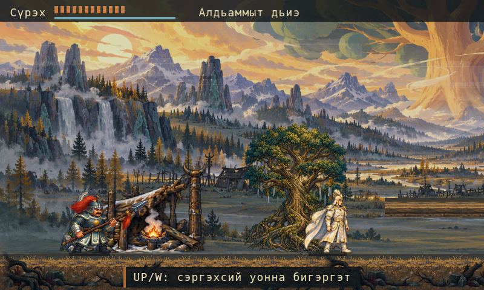
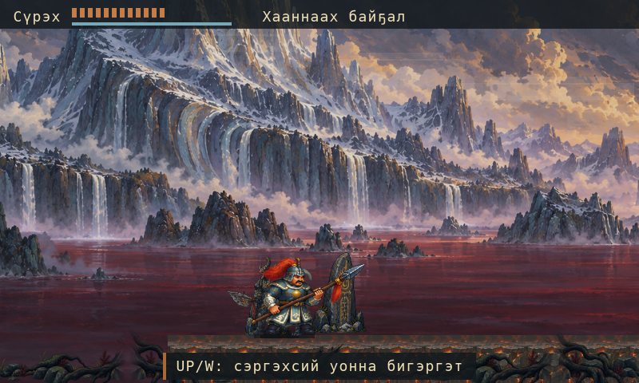

# Nyurgun 0.4.15：5 つの絵画調の世界と読み取りやすい戦闘 { #nyurgun-0415-five-painted-worlds-and-clearer-combat }

*2026 年 10 月 15 日 · ローカル開発レポート*

Nyurgun 0.4.15 は、救出編の 5 地域の絵と、戦闘・回避・HUD の修正をまとめたローカルビルドです。
Wick と Lantern で制作する、サハのアクション探索ゲームです。タイトル画面では選択の移動を
確定より先に処理します。明示的に新しく始めた救出編や未完了の救出編を Continue で優先し、
通常の物語への移行条件も保っています。

## 変更したこと { #what-changed }

4 枚の背景は 2290×687 の画像全体を保持しています。5 枚目は、保存済みの
2167×725 の原画から 2160×648 の領域を正確に切り出しました。画素の再サンプリングや
拡大は行わず、背景の論理的な描画範囲は 800×240 のままです。
以前の書き出しデータとダウンロードした原画も、そのまま残しています。

*現在の美術を、実際の Wick VM と Lantern のラスタライザーで描画した固定状態です。
800×480 のヘッドレス画像であり、ネイティブウィンドウのスクリーンショットではありません。*

被弾や回避で、残っていた攻撃を中断するようにしました。制作済みの 4 つの転がるポーズが、
回避の有効時間に沿って再生されます。HUD をコンパクトにして戦闘が見える範囲を広げ、
近くで行える操作、物語の目標、セーブ警告はサハ語、ロシア語、英語で読み取れるように
保っています。停止中や会話中には、最初の操作案内の表示時間を消費しません。
既知の復元失敗では Retry／Begin anew の選択肢を保ち、明示的な再開始では選んだ章の保存領域だけを変更します。

*カメラを固定し、実際のゲーム描画を実行した画像です。主人公と地形は変えていません。*

## 検証したこと { #what-we-verified }

本番ゲームコードを変更せず、空の専用セーブ領域と通常の操作入力で、救出編から
第 VIII 章まで 12,567 フレームを通して実行しました。20 枚の画像を取得し、
地図の表示と復帰も 4 回確認しました。美術データの検証では、現行データの 190 項目、
過去のデータを守る 14 項目、インポーターの全 27 契約が通過しました。
美術データの独立レビューに未解決の指摘はありません。さらにタイトルの操作、章への移行、
保存処理の 273 項目も通過しました。

ローカルの 0.4.15 macOS アプリは、リソースの完全一致と厳密なアドホック署名の検証に通過しました。
ネイティブのサハ語タイトル画面と上下キーによる選択の移動を目視確認しました。
Enter キーでの決定、ゲームプレイ、保存データの復元は行っていません。公証は未実施です。

*選択した原寸の切り出しを使う、実際のヘッドレスゲーム描画です。ネイティブプレイの証拠ではありません。*

## 引き続き制作すること { #still-in-production }

原画のダウンロードは 10 点を検証済みです。救出編の絵が 5 点、後続の第 VI 章用候補が 2 点、
Gemini のシートが 1 点、未承認の R8／R9 歩行シートが 2 点です。Gemini Pro High ではそのシートを生成できましたが、
その後は利用枠の制限で生成できなくなりました。第 VI 章の候補と Gemini・R8・R9 のシートは未導入です。
承認済みの音声・音楽テイクは 0 件です。

Castlevania: Belmont's Curse の品質を引き続き目指します。全編のネイティブプレイ、
完全な 4K 原画と表示、文化面の確認、流暢なサハ語話者による確認、叙事詩全体の実装は未完了です。
これは [Nyurgun のソースプロジェクト](https://github.com/alikatgh/nyurgun)の進捗報告であり、
アプリの一般公開ではありません。
