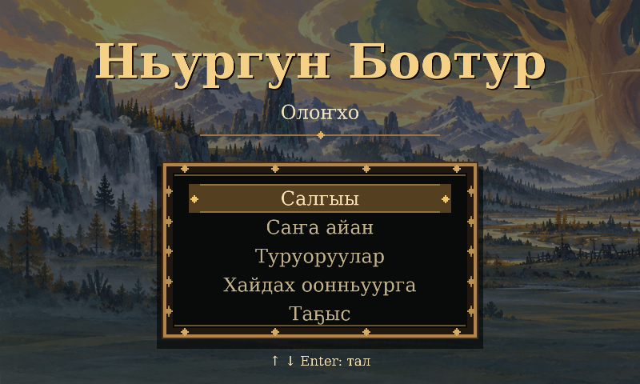
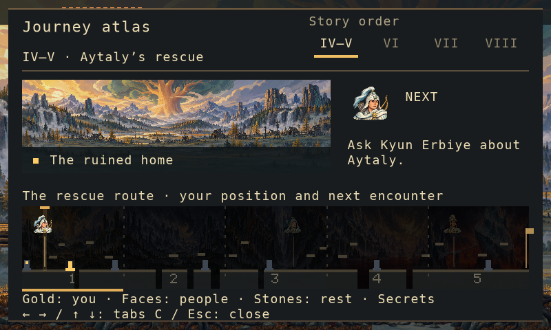
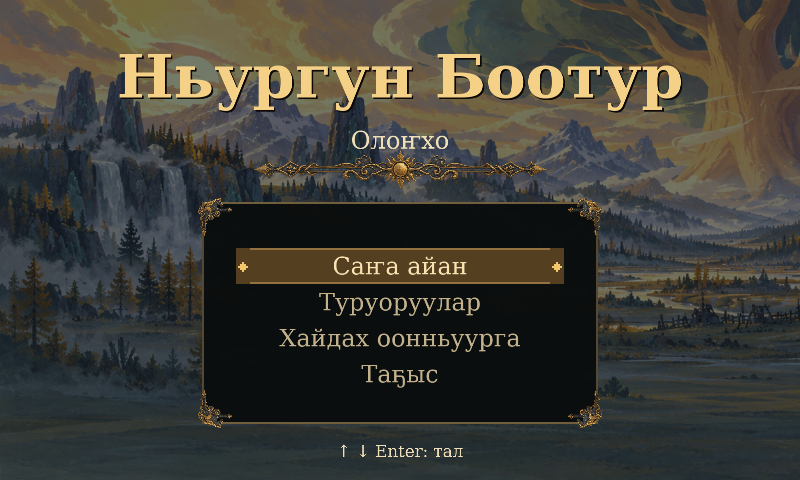
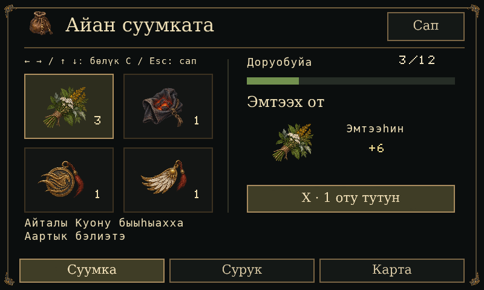
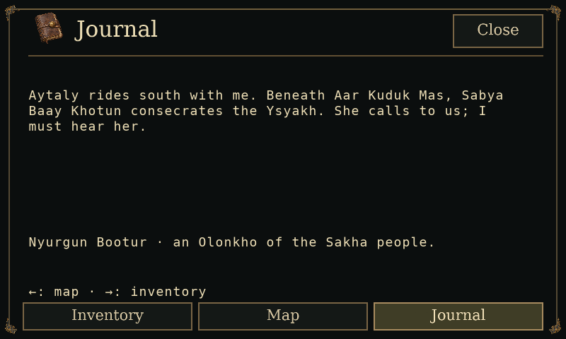
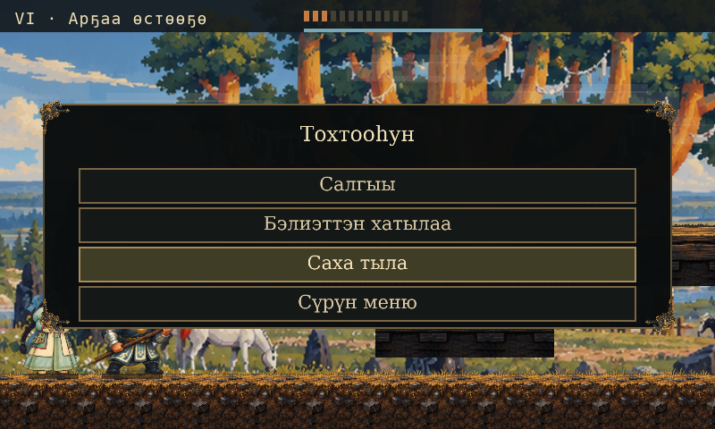
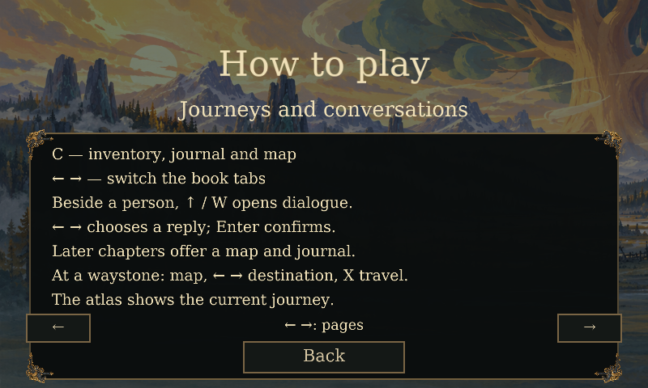

# Nyurgun 0.4.16：メニュー、旅の手帳、決闘を読み取りやすく { #nyurgun-0416-menu-journey-book-and-duel }

*2026 年 10 月 15 日 · ローカル開発レポート*

Nyurgun のタイトル画面を、大きなセリフ体の題字と、木材・青銅色の中央メニューで
構成しました。背景はサハの故郷を描いた絵です。Continue、New journey、Options、
How to play、Quit を選択表示で操作できます。Options では実際のゲーム言語を変更でき、
サハ語を既定として、ロシア語と英語も選べます。題字とメニューにはオープンフォントの
DejaVu Serif を使い、サハ語の文字をすべて保持しています。

旅の手帳と会話への入り方も明示しました。C キーで持ち物・日誌・現在の経路図を開き、
左右キーでタブを切り替えます。後続の章には、その章の地図と日誌があります。
救出編ではポーズメニューから各タブを直接開けます。人物のそばで上キーまたは W を押すと
会話が始まり、左右キーで返答を選び、Enter で確定します。地図が示すのは実装済みの旅の
範囲であり、オロンホ全体を移動できる広域マップではありません。

絵画調の地形では、上端の不透明な余白を透明化しました。地形の支持位置に合わせて描画を
ずらし、人物の足裏と地面の見える面をそろえています。第 VI 章の決闘では、敵の隙と、
実際に攻撃が届く状態を区別します。向き、武器の接触範囲、有効なポーズに達するまでの時間、
攻撃後の待ち時間を案内に反映しました。転がる回避の表示も、習得状態・集中力・再使用待ちに
従います。

*画像はすべて、状態を固定して実際の Wick VM と Lantern で描画したヘッドレス検証画像です。
ネイティブウィンドウの画像や、全編を通したプレイの証拠ではありません。*

## 検証したこと { #what-we-verified }

実際に組み立てたゲームで、メニュー・手帳の 43 項目、保存済みタイトルの 49 項目、
章への移行の 156 項目、決闘の 56 項目が通過しました。合成入力によるパッケージ検証も
63 項目が通過しています。空の専用セーブ領域と通常の操作入力によるヘッドレス実行は、
第 VIII 章まで 12,567 フレームで到達し、20 枚の画像と 4 回の地図表示・復帰を確認しました。
独立レビューに未解決の指摘はありません。

ローカルの Apple Silicon 向け macOS アプリは厳密なアドホック署名検証に通過しました。
46 個のアプリファイル、41 個のリソース、43 個のソース・ランタイム照合を記録した入力に
結び付けています。以前の 0.4.15 アプリの全ファイルは変更せず保持しました。
ネイティブで目視確認したのは、サハ語のタイトル、マウスでの Options／Back、キーボードでの
操作案内、既存の VI 章セーブからの再開、持ち物と地図、絵画調の地面上での通常移動です。
ネイティブでのボス撃破、全編のプレイ、フレーム間隔の計測は未検証です。
公証とアプリの一般公開は行っていません。

全編のネイティブプレイと表示の安定性、目標とする Castlevania 相当の作り込み、完全な 4K 表示、
文化面と流暢なサハ語話者による確認、公証、叙事詩全体の実装は未完了です。
承認済みの音声・音楽テイクは 0 件です。0.4.13 と 0.4.15 の成果物・記事は保存しています。

## 0.4.17 更新：薬草と地図からの移動 { #herbs-and-map-navigation }

救出編と第 VI 章の持ち物画面に、薬草の数、現在／最大体力、X キーで 1 個食べる操作を
示す共通のカードを追加しました。表示する回復量は実際に回復できる値で、上限は 6 HP
です。体力が 11/12 なら「+1」と表示します。体力が満タンの場合と薬草がない場合は、
使用できない理由を示します。回復処理とセーブの仕組みは変更していません。

第 VI 章の地図では、左キーで持ち物、右キーで日誌へ移動します。救出編の地図では、
下キーで持ち物、上キーで日誌へ移動します。

実際のローカル 0.4.17 アプリは、対象テスト 47 項目と 3 言語の検証画像 33 枚、
パッケージテスト 63 項目、厳密なアドホック署名検証を通過しました。独立レビューに
未解決の指摘はありません。ネイティブで確認したのは、保存済み第 VI 章の持ち物
（薬草 3 個、体力 20/20）、満タン時に X を押しても薬草が減らないこと、地図への
移動と持ち物への復帰です。体力が減った状態でのネイティブ回復、全編の再実行、
地図からの移動実行は再検証していません。0.4.16 アプリの全 46 ファイルは保持し、
新しい画像や音声は組み込んでいません。

## 0.4.18 更新：ティミルの剣の届く範囲 { #timir-sword-reach }

第 1 段階のティミルの振り下ろしは、剣が届かない遠方でもプレイヤーにダメージを
与えていました。修正では、前方の距離と高さを持つ同じ剣の領域を、ダメージ判定、
警告、明るい斬撃の表示に使い、ティミルの向きに合わせて反転します。振り上げと
振り下ろしの姿勢を攻撃に合わせ、斬撃表示も攻撃終了時に終わります。低いなぎ払いは
左右どちら向きでも通常の Z キーのジャンプで避けられます。攻撃のタイミング、HP、
後半の段階、組み合い、セーブ形式は維持しています。

実際のローカル 0.4.18 アプリは、対象テスト 103 項目と検証画像 22 枚、
パッケージテスト 63 項目を通過しました。通常の操作入力によるヘッドレス実行は、
第 VIII 章まで 12,563 フレームで到達し、20 枚の画像と 4 回の地図表示・復帰を
確認しました。独立レビューに現在未解決の指摘はありません。厳密なアドホック署名と
43 個のソース・ランタイム照合で新しいアプリを記録した入力に結び付けています。
以前の 0.4.17 アプリの全 46 ファイルは変更せず保持しました。

ネイティブで確認したのは、正確なアプリのサハ語タイトルと、Continue から体力が
満タンの第 VI 章の野営地への復帰です。その後の操作検証はユーザー入力で中断されたため、
ネイティブでの遠距離判定、ボス撃破、フレーム間隔の計測は確認済みとしていません。
新しい画像や音声は組み込んでいません。

## 0.4.19 更新：絵付きの持ち物、マウス操作、ティミルの決着 { #illustrated-inventory-mouse-and-timir-finish }

既存の絵画調の小物を使い、持ち物を選択できるカードで表示します。ポインターを
合わせるとカードが強調され、薬草のカードには数、体力、実際の回復量を示します。
手帳、メニュー、会話、進行・再試行の案内もクリックに対応します。キーボード操作も
維持し、押し続けたクリックや同時の X 入力で回復を重複して実行しません。

ティミルは既存の 12 個の姿勢を、対応する順序で使います。残り 2 HP では、必要な
組み合いに進むまで安全なよろめき状態で待ちます。上キー／W を押しながら近づくか、
範囲内で案内をクリックします。その後の鞭と懇願の場面も維持します。

最終の組み立て済みソースは、ポインターの 85 項目と画像 31 枚、第 1 段階の攻撃範囲の
76 項目を通過しました。決着の入力 17 項目と姿勢・UI の 53 項目は直前のソースに
結び付き、その後の VI 章のマウス処理 4 か所は別途レビューしました。最終の通常入力
によるヘッドレス実行は、第 VIII 章まで 12,602 フレームで到達し、20 枚の画像と
4 回の地図表示・復帰を確認しました。ランタイム同梱の 42 項目とパッケージの
69 項目も通過し、独立レビューに未解決の指摘はありません。厳密なアドホック署名と
43 個のソース・ランタイム照合でローカルアプリを記録した入力に結び付けています。
以前の 0.4.18 アプリの全 46 ファイルは変更していません。

ネイティブでは、ポインターとタイトル、マウスによる VI 章への再開、体力 20/20・
薬草 0 個・使用不可の Eat を示す絵付きの持ち物、Map／Close、ポーズと Resume を
確認しました。ネイティブで薬草を使うこと、ボス撃破、フレーム間隔の計測は未検証で、
アプリは未公証です。

読み取り専用の監査は、Downloads 直下と素材名の特定フォルダーにある対応形式の画像
1,392 件を対象にし、Nyurgun と完全一致する 75 件、27 系統の素材、81 件の参照を
照合しました。一致した原本は変更せず、10 件の新しい候補は未使用です。個人用の
全フォルダーやアーカイブを調べたという意味ではありません。新しい画像・音声は
組み込んでいません。承認済み音声は 0 件で、文化面の承認も未完了です。

## 0.4.20 更新：持ち物の新しい絵とメニュー装飾 { #painted-inventory-and-menu-ornaments }

新たに生成した 6 点の絵で、薬草、石炭、ダッシュ、翼、日誌と袋の見出しを示します。
タイトル、手帳、ポーズ、ヘルプには独自の隅飾りを配置しました。ヘルプは下部の操作欄を
確保し、改訂した章のポーズ画面では 4 つの隅飾りがボタンに重ならないようにしています。
ゲーム進行、マウス・キーボード入力、回復、セーブ形式は維持しています。

画像は実際の Wick レンダラーによるヘッドレス検証です。最終 R2 の描画では、新しく検証した
ポーズ画面 36 項目と、変更のない既存の UI・ヘルプの証拠を合わせ、有効な UI 検証は
150 項目・105 枚、ポインターは 85 項目・31 枚です。無損失パッカーの60項目とソース起動の
16項目が通過しました。実際の最終ソースによる通常入力のヘッドレス実行は第VIII章まで
12,602フレームで到達し、20枚の画像と4回の地図表示・復帰を確認しました。独立レビューに
未解決の指摘はありません。厳密なアドホック署名で48ファイルと45個のソース・ランタイム
照合を検証し、旧0.4.19の46ファイルと初版0.4.20の48ファイルは維持しています。
ソースからの起動は、検証済みポインター対応ランタイムがあれば優先し、明示指定も保持します。

ネイティブのCUA確認は、正確なR2アプリのタイトルとポインター、マウスによる再開、完全に
見える4つのポーズ隅飾り、Resume、体力20/20・薬草0個の持ち物、日誌と地図、Close後の
接地状態を対象にしています。Closeのホバーも見えます。保存したネイティブ画像のハッシュは
主張していません。薬草の使用は観察していません。

要求した原画像の 48 ピクセルの余白は不合格でした。限定条件付きの格納では、512 ピクセルの
RGBA セル全体と 8 ピクセルの間隔を保持し、境界のアルファ値 1 の 28 ピクセルと、小さな
離れた成分 1,220 個も残しています。マット、マスク、再サンプリングで隠していません。
従来の画像 36 点と過去のアプリは維持しています。ネイティブでの全編・ボス撃破・薬草使用、
フレーム間隔の計測、公証、文化面・サハ語の承認、承認済み音声は未完了です。
