# Nyurgun: painted worlds, characters and story in Wick

*12 October 2026 · Local development report*

Nyurgun is a story-driven Sakha action-exploration game written in Wick. Its
traversal and combat draw on Castlevania; conversations, inventory and decisions
draw on Ultima. The aim is to bring Sakha literature and visual art into a game
whose people, places and choices carry the story. The production vision is a
fully AI-authored game held to the craft expected of human-made work: coherent
art direction, distinct characters, purposeful animation and carefully edited
story and sound.

The narrative follows the Orosin/Ergis 1947 text. The local working game joins
the five-region Aytaly rescue arc of chapters IV–V to source-audited episodes
VI, VII and VIII, including the northern departure. These are parts of a much
larger epic. The characters need room to speak and act as people, with their
own relationships and reasons to help, resist or leave.

*Development prototype captured through the real Wick VM and Lantern software
renderer with headless presentation. This is not native-window validation;
the art remains unfinished.*

## Paint that survives the renderer

The visual target is the selected painted Yakut epic illustration style:
expressive faces, detailed clothing and metalwork, and landscapes with depth.
The current game remains below that target. Clearer Unicode text, layered
parallax, a regional map, character portraits and action poses are steps toward
making the scenes readable and the people distinct.

The renderer keeps gameplay coordinates at 400×240 while bounding
physical density to 1–4. The native launcher configuration defaults to 2,
giving an 800×480 framebuffer. More pixels preserve available painted detail;
they do not change movement or level geometry.

The art pipeline now distinguishes explicit BMP V4 alpha from the older
magenta colour-key format. Alpha-weighted bilinear filtering retains soft
painted edges, while opaque-pixel arithmetic remains compatible. Export checks
preserve 714,269 partially transparent pixels across 15 alpha atlases.

The world tree comes from a retained, project-generated props painting. An exact
224×224 source crop was copied unchanged into a padded 256×256 atlas cell at
four times the previous atlas density. Its original detail was preserved
exactly; nothing was enlarged or invented. A faint fringe already present in
the source remains a visual review item.

The painted-alpha renderer is now merged into Lantern's main source through
[upstream pull request #2](https://github.com/alikatgh/lantern/pull/2).
The public Lantern download remains 0.8.0.

## Recovering character detail

Eight portrait cells and four preparation poses now recover detail from the
original retained project-generated paintings at four times their previous
atlas density. Character identity, framing and root anchors are preserved.
This increment adds no new artwork or animation.

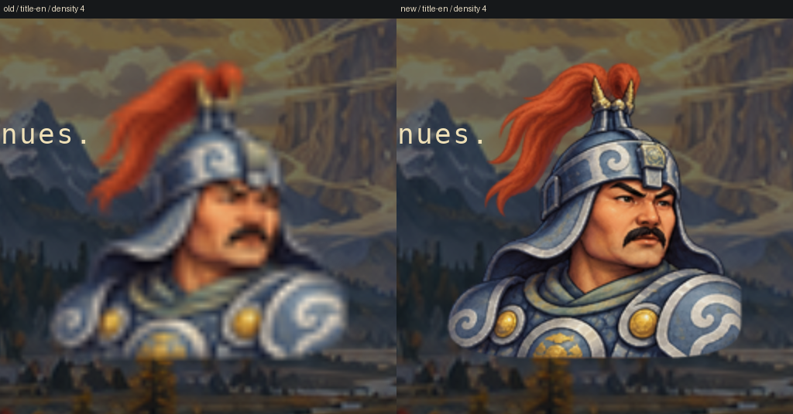

*Old atlas on the left, recovered detail on the right. Both use the production
draw path from the same fixed headless state after two frames at physical
density 4. Faces and armour details are clearer; native presentation and final
visual quality remain unreviewed.*

## Recovering the supporting cast

Faces, braids and embroidered clothing need to remain readable during play.
The twelve-slot Chapter VI–VIII cast now recovers four times its previous atlas
detail directly from three retained project-generated paintings. The same
characters, complete paired handover, foot roots and walking cycle remain;
this adds no poses or anatomy repair.

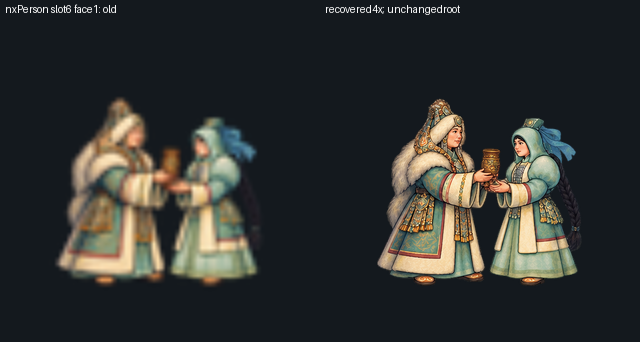

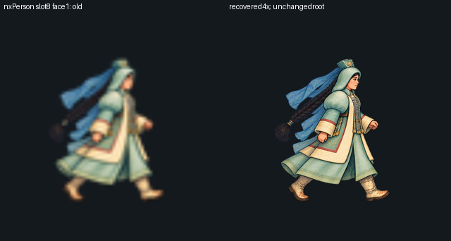

*Fixed-state comparisons through the actual game draw functions at physical
density 4. These show recovered source detail with unchanged framing; they do
not establish native animation quality.*

Independent reconstruction compares every source-derived RGBA channel, and
28 importer rejection controls plus 24 production draws check all twelve slots
in both facings. Fresh independent review passes, as does the implemented
campaign in **11,934 ordinary-input frames** with the new art.

This later source change is not in the preserved 0.4.6 review archive. The
opening messenger and rescue-arc actors use a separate props atlas and still
need their own detail work. A recorded face-size mismatch and concealed hip/gait
limitations in one Aytaly pose remain; native play and final visual/cultural
approval remain open.

## Recovering the rescue characters

Captive Aytaly, the celestial messenger and Aiyy Umsuur now draw from a separate
atlas at four times their old packed density. It copies selected pixels from
our retained original generated paintings without resizing them. Their logical
size and foot position stay the same; the old props atlas is preserved.

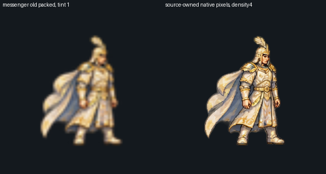

The new mask contract makes its boundaries explicit: very faint pixels, smaller
components and the lower source crop boundary are excluded. It does not reconstruct
the unknown historical packing mask or prove complete silhouette ownership.
Eighteen actual prop draws at three physical densities, independent source-channel
checks and fresh review pass. This is clearer static art, with animation and
final cultural review still ahead.

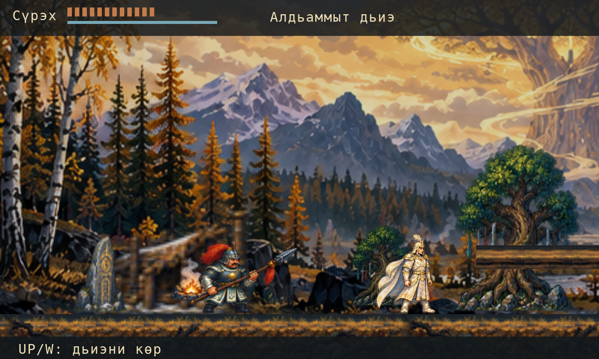

The **0.4.8 local Mac review candidate** includes these actors and the journey
atlas. It is built, signed and archive-verified; the ordinary-input headless
campaign again passes 11,934 frames at density 1. The seeded scenes above are
render checks, not native-window screenshots. Native desktop review remains
blocked by the computer-control connection despite enabled permission. No
approved AI recordings are bundled, and the whole epic remains unfinished.

## A journey atlas for the epic

The journey atlas now follows the implemented rescue arc of chapters IV–V and
chapters VI, VII and VIII. The chapter index shows the story order. Each map brings
together the current place, the next character or goal and a crop from the
painted scene. The rescue map keeps the actual five-region geometry and
landmarks, so it remains useful for finding a way through the world.

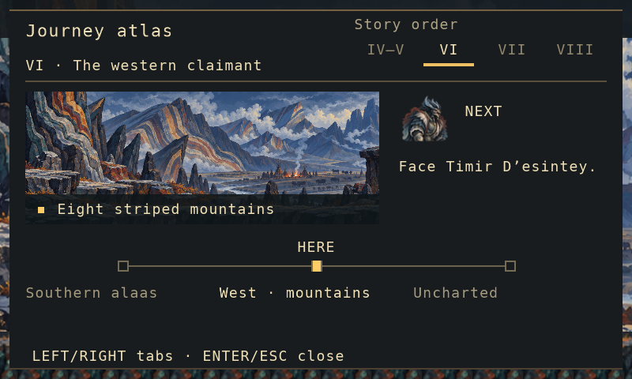

*Chapter VI at physical density 2, drawn from an assembled game state through
the real Wick VM and Lantern renderer. The opaque panel and clear HD text keep
the map readable over the painted world.*

Chapter VIII separates Nyurgun’s present northbound route from Sabya’s account
of the past. It leaves unknown distances and fates unknown, rather than filling
the gaps with invented geography or outcomes.

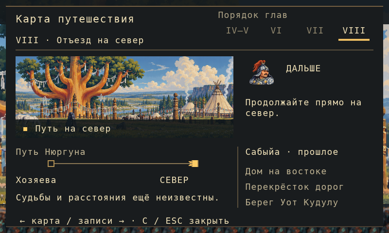

*The present journey and the reported past appear in separate areas of the map.
This is a seeded headless capture, not a native play session.*

The new labels are available in Sakha, Russian and English; Sakha remains a draft
awaiting fluent review. **51 seeded render fixtures across all three languages**
pass at physical density 2, using the assembled game. Controls check stale
previous-chapter state, standalone restores and text bounds. These are seeded
headless checks of the atlas.

Separately, the complete implemented campaign passes with ordinary inputs, map
open/pause/resume controls and unchanged saving at software density 1. A full
density-2 campaign timed out in Chapter VI; the HD fixtures above do not substitute
for that run.

The **0.4.7 local Mac review candidate** is built, signed and archive-verified.
It remains unnotarized. Desktop-control access failed even with permission enabled,
so no successful new native game window or native play cadence is verified.
No approved AI voice or music takes are bundled, and the whole epic remains
unfinished.

## Reviewing the integrated candidate

The new **0.4.6 local Mac review candidate** brings the sharper 32-pose hero,
sword/whip atlas and Chapter VI hurt/death priority into one package with the
recovered painted worlds and native audio runtime. Its unchanged source passes
the implemented rescue-to-VIII campaign in **11,934 ordinary-input frames**.
Eight captures from the exact package cover three-language titles/dialogue,
the opening and the map at physical density 2. Independent artifact review
checks the packaged source, artwork, signatures and archive bytes/permissions;
earlier candidates remain unchanged.

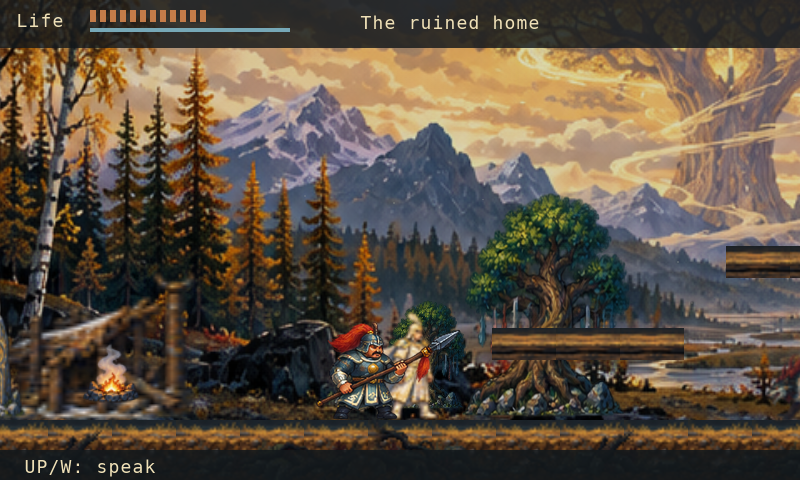

This is a local, unnotarized review archive, not a public game release. Native
desktop control remains unavailable; no successful 0.4.6 game window or hardware
sound is verified. VoiceStudio/YuE takes, final visual and cultural approval,
fluent Sakha review and the complete epic remain unfinished.

## Recovering main-character poses

All 32 main-character poses now recover twice their previous atlas detail from
the original R4 and roll paintings. The 2048×512 texture retains the same logical
grid, foot roots, frame IDs and timing. Every source scale stays below one.
Historical crop losses and ownership exclusions remain recorded; this is source
recovery, not anatomy repair or additional animation.

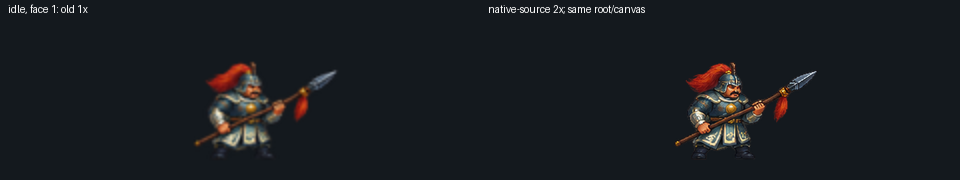

*Actual production-draw comparisons at physical density 2, with unchanged
framing. These fixed poses do not establish native animation quality.*

Independent checks reconstruct the earlier atlases exactly, compare all
4,194,304 RGBA channels per export, and reject 35 importer mutations. Sixteen
renderer comparisons cover eight pose classes in both directions; every
shifted-root control is rejected. Fresh independent review and a primary
renderer rerun pass. [The source/art update is merged into main](https://github.com/alikatgh/nyurgun/pull/8).
The preserved 0.4.5 app predates it; native and overall visual approval remain open.

## Recovering painted sword and whip poses

Chapter VI now retains twice the previous atlas detail in its sword and sacred-whip
poses. Fifteen original painted poses supply sixteen 512×192 physical cells;
the logical canvas, foot roots, frame indices and animation timing stay the same.
The new atlas is recovered from the original generated paintings at scales below
one, without enlarging the old packed sheet.

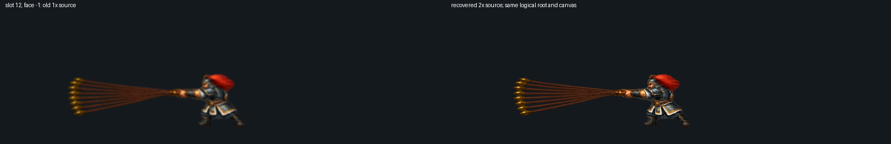

*These fixed-state comparisons use the actual game draw path at physical density 2.
They show recovered detail, not an approved animation or native play session.*

Exact source reconstruction checks all 6,291,456 atlas RGBA channels. Twenty-one
importer rejection controls, eight renderer comparisons and eight shifted-root
controls pass. Fresh independent review found no defects.
[The source/art change is merged into main](https://github.com/alikatgh/nyurgun/pull/7).
The preserved 0.4.5 app predates it; overall character quality still needs work.

## Recovering the painted worlds

All ten panoramas now retain exact crops from the original project-generated
paintings, instead of being reduced to 800×240 during import. Their textures
are 960×288, 1320×396 or 1600×480. Every crop keeps its original RGB pixels;
the old exports were not enlarged. Logical framing, camera motion, terrain
and character positions remain unchanged.

Independent checks compare 5,469,600 source pixels and preserve every original
and non-world export. The selected inputs total 13,033,476 bytes within the
unchanged 30 MiB bound. Old/new scenes were compared through the real renderer
at physical density 2, with actors, interface and both camera-pan endpoints.
This recovers visible brushwork and cliff detail. Further character animation,
world composition and native presentation still need work.

## A continuous fresh-save campaign

The implemented rescue → VI → VII → VIII route now passes in one continuous
11,934-frame run from empty private saves. Ordinary keyboard inputs drive the
unchanged Wick controllers, combat and traversal; all four chapters write their
normal saves with no save warnings. The verifier checks canonical assembled
source, contiguous chapter order and sixteen required scene captures.

This is headless gameplay evidence using the real VM, renderer and audio mixer
with synthetic OS input, presentation and audio output. It does not establish
native play or an adaptation of the whole epic.

The new local 0.4.5 review app packages Lantern main's audio and compiler checks
with the recovered worlds. It passed exact resource, ARM64/macOS 15, signature
and extracted-archive verification. Runtime preparation rebuilds 37 hash-verified
source inputs before probing the typed audio API. Older apps remain preserved.
An automated launch attempt stopped during macOS application registration,
before Wick/game initialization. Successful native play remains unverified;
this is not a public executable release.

## A game that makes the tools answerable

The rescue and later episodes exercise dialogue, inventory, progression,
interaction prompts and saving. The departure adds a paired catch and recovery
sequence followed by four armament poses. Targeted checks run the real Wick
compiler, VM and renderer, rather than substituting game logic in a test mock.

A later Chapter VI source repair gives Nyurgun's hurt and death poses priority
when a sword or whip swing was active. Twenty-four painted fixture cases cover
both directions, held death, ordinary retry and attacks during later invulnerability.
The same regression rejects the earlier source, and the final assembled campaign
again passes from empty saves in 11,934 frames. These are headless checks; the
preserved 0.4.5 app predates this repair.

## Voices and music belong to the game

[Native audio is now merged into Lantern main](https://github.com/alikatgh/lantern/pull/4).
Wick can address sound effects, music and speech separately, keep stable voice
handles, pause a line, fade it out and crossfade music on the mixer sample clock.
Audible speech can lower the music and release it after the line ends. The
callback performs no file access, allocation or asset deallocation.

Nyurgun's source now routes dialogue by its exact subtitle key, character and
selected language. Advancing or skipping a line retires the old voice; pause and
journal screens suspend playback, and a language change cancels the previous
language. The audio controller also follows the later cinematic sequences and
scene music. Missing optional recordings leave text and progression available.

[VoiceStudio](https://github.com/debpalash/VoiceStudio) is the required voice
production tool, and [YuE](https://github.com/multimodal-art-projection/YuE) is the
required music tool. The production plan covers eight character and narrator
directions, 219 speech entries across Sakha, Russian and English, and seven music
cues. These are plans, not finished performances. Versioned command-line adapters
prepare bounded, inspectable jobs and provenance records; they do not install
models, start inference or silently substitute another generator. The initial
music contract pins the original YuE-v1 source and models separately from YuE2.

Recordings must pass listening, editorial, cultural and rights review before the
asset manifest admits them. Packaging checks the approved file hashes, current
subtitles and generated loaders, and rejects a runtime without the native audio
capability. No approved AI voice or music takes are bundled yet. The public
Lantern 0.8.0 download and retained Nyurgun review apps remain unchanged.

The real engine tests passed 594 assertions and all 12 CTest targets. Nyurgun's
source passed 22 audio integration assertions, 154 episode-entry cases and a
5,425-frame production self-play run. These checks use synthetic audio or
headless presentation; hardware playback, listening quality and final character
performances remain unverified. WAVs are decoded into bounded memory;
streaming and compressed codecs remain future work.

## An agent-facing compiler check

Lantern source now provides `lantern check --json game` for agents and other
tools. It runs the real Wick compiler with the same Lantern API signatures,
without opening a window or executing top-level game code or native calls.
[The compiler-check change](https://github.com/alikatgh/lantern/pull/3) returns
a single structured JSON result with diagnostics. Source input is
capped at 8 MiB and nesting depth at 256; a constant pool that exceeds its
16-bit index range is rejected rather than allowed to wrap.

This is one step toward tools an agent can use directly. Deterministic headless
scripting, runtime-state inspection and runtime instruction budgets remain
future work.

Sakha is the game's language foundation. English and Russian are the immediate
editing focus, while Sakha wording awaits review by a fluent speaker. Native
presentation, native campaign play and cultural accuracy still need review.
This report records implemented engine and game work and the quality we are working
toward, with further character animation and painted-art refinement ahead.

## 64-bit by default, with an explicit 32-bit choice

Nyurgun remains a 2D game. We are targeting detailed painted characters and
worlds, fluid animation, layered motion and edited audio on modern native
64-bit hardware. Historical console influences guide the craft; binary width
alone does not establish presentation quality.

The first concrete platform change is in Wick and Lantern's build contract:
native 64-bit is the default, and developers can explicitly select
`-DWICK_HOST_BITS=32` with a matching toolchain and dependencies. A mismatch is
rejected. Direct Wick embedding enforces the same choice. Agents and developers
can inspect a compiled runtime with `lantern --build-info --json`, without
opening a game or executing its code. See the [reference](../../types/#native-64-bit-builds-and-numeric-precision).

Wick's existing `num` uses binary64 on the verified target, with 53 bits of
integer precision. Exact 64-bit integer types remain separate language work.
Nyurgun's retained 0.4.8 Mac executables are already ARM64; this source increment
does not replace that app or its ZIP. Actual 32-bit builds and the Windows,
Linux and Intel Mac target matrix remain unverified.

Lantern currently hosts the game. Ember32 models a separate ARM7 virtual console;
a proposed Ember64 native runtime tier would need to preserve Wick, painted
RGBA rendering, audio and saves before hosting Nyurgun. That tier and the
reusable desktop runner remain planned work. Neither is claimed as a released
feature, and this build-policy change adds no new art or approved recordings.

## More source detail and a readable first gate

Local candidate 0.4.9 recovers retained painting detail across 15 atlas families.
Repacking adds 33,436,160 atlas pixels, including transparent space.
All 27 art contracts pass; logical roots and animation timing stay unchanged.
Ten world panoramas, the rescue cast and the tree already retain available
original detail. This does not make every asset 4K: an 8,192-pixel-wide action
atlas is a strip of poses, not an 8K character.

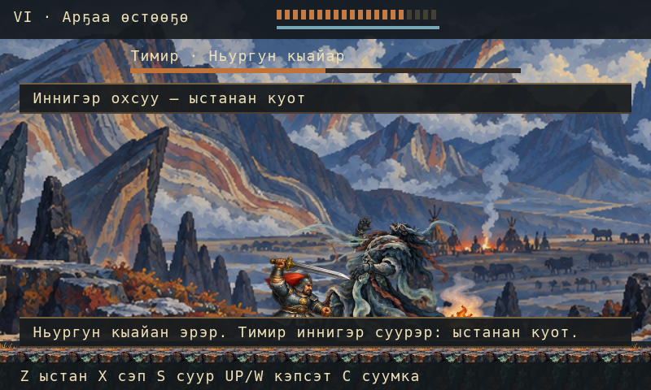

*Chapter VI in the verified headless campaign at default density 2. Sakha
wording remains an unreviewed draft.*

The first gate now explains when to seek the messenger's clue or hearth coal,
preserving the story prerequisites. A 700-frame ordinary-input route and 18
localized guidance views pass. The frozen default-density-2 rescue→VI→VII→VIII
campaign completes in 11,970 frames, with 20 captures and four map returns;
protected source and resource bytes remain unchanged.

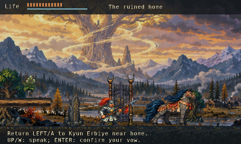

*English gate guidance from the real Wick VM and Lantern renderer, using
test-only OS presentation. This is headless evidence.*

Actual VM font renders pass 84 Latin/Sakha letter-pair checks at densities
2, 3, 6, 9 and 10, including scaled text. Independent raster-layer comparisons
differ by at most one RGB level.

[Lantern PR #6](https://github.com/alikatgh/lantern/pull/6), merged into main at
`d59b521`, has green PR/main CI, all 15 CTests and iOS compilation/linking.
The experimental renderer bounds its framebuffer to 4,000×2,400, supports
densities 1–10, exposes framebuffer-size APIs and adds a 2D fast path.
Measured 4K CPU rendering still takes about 181 ms before upload; default
density 2 stays unchanged. This is not 4K-ready.

The signed local app and ZIP/DMG packages are review artifacts. The app has not
successfully launched; native presentation is unverified and it is unnotarized,
with zero approved AI voice/music takes. Native play, performance, cultural
review and the finished game remain open.

## Rendering painted worlds with bounded workers

[Lantern PR #7](https://github.com/alikatgh/lantern/pull/7) adds an opt-in painted
2D compositor: direct affine sampling, alpha-weighted filtering, atlas-cell
clamping and a persistent pool bounded to eight workers, with serial fallback.
Typed Wick APIs report the actual mode and worker count; build-info exposes the
capability to agents and packaging.

The map previously redrew the world behind its opaque panel. The compositor now
skips earlier pixels covered by one later opaque untextured rectangle, preserving
the visible border, alpha and draw order. Tests include 336 byte-exact comparisons
against unculled painted rendering, clipping, translucent/textured covers and
transformed boundaries. All 16 engine CTests pass with test presentation; fresh
independent reviews found no remaining code findings.

A source-stable check runs the real Wick VM, production callbacks and CPU
renderer through 1,848 ordinary-input frames. English/Russian title, opening
gameplay and map states match between one and eight workers. Sources and private
saves remain unchanged during measurement, and all phase framebuffer digests
match the preceding compositor.

Final eight-worker CPU timings at 3600×2160 are:

| Scene | English median / 95th percentile | Russian median / 95th percentile |
| --- | --- | --- |
| Title | 22.9 / 30.9 ms | 20.0 / 28.1 ms |
| Opening gameplay | 35.0 / 48.7 ms | 30.4 / 48.5 ms |
| Map | 19.9 / 25.8 ms | 10.5 / 25.1 ms |

Each case uses 30 warmup and 120 measured frames on one development Mac; native
display upload and audio-device work are excluded. Timing varied between runs.
The synthetic covered-map case improved from 17.8 to 2.5 ms median with an
identical framebuffer, but the real game still exceeds the 16.67 ms budget.
Sustained native 60 FPS remains unfinished.

New Nyurgun packages select the painted compositor by default and require proof
from a pinned reviewed runtime, with an explicit legacy option. Density 2 and
explicit native/density overrides remain. The retained 0.4.9 app, ZIP and DMG
are unchanged.

Full 4K art is unfinished. An 800×240 logical scrolling panorama needs roughly
7200×2160 source pixels at this density. Enlarging current originals cannot
supply that detail. New paintings in the existing project art conversation,
paged animation atlases, measured texture-memory budgets and native visual
review remain required. No new artwork or approved AI recordings are claimed.

## Local Mac installer 0.4.10 { #local-installer-0410 }

The **0.4.10 local review app** packages the verified `painted-2d-v1` runtime
for Apple Silicon Macs running macOS 15 or later. Density 2 remains the default;
higher densities are experimental. The preserved 0.4.9 artifacts stay unchanged.

The app is ad-hoc signed and unnotarized. The local DMG is built and passes native
CRC verification. [Installer evidence](https://github.com/alikatgh/nyurgun/blob/main/docs/verification/painted-installer-0410.json)
records exact checks of all 43 staged-app files/resources and unchanged source
inputs. All 54 macOS packaging checks pass, and fresh independent source review
reported no findings. The installer is a private local review artifact, with no
public download.

Opt-in `--clone-files` packaging requires native APFS copy-on-write clones.
Each cloned file is independent, and cloning failure stops packaging without
a full-copy fallback. Normal copying remains the default.

Mounted-image contents and native window/play remain unverified. Actual 60 FPS,
full 4K source artwork and final art/audio approval remain unfinished. Zero approved
AI voice or music takes are bundled.
