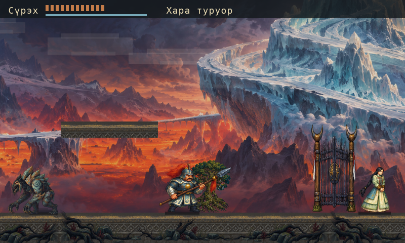

# Nyurgun 0.4.15: five painted worlds and clearer combat

*15 October 2026 · Local development report*

Nyurgun 0.4.15 combines five painted rescue worlds with combat, dodge and HUD
repairs in our Sakha action-exploration game, written in Wick for Lantern.
Title navigation now precedes confirmation. Continue respects an explicit new
or incomplete rescue; fresh-story guards remain intact.

## What changed

Four backgrounds retain complete 2290×687 images; the fifth is an exact
2160×648 crop of its preserved 2167×725 original. No pixels are resampled or
enlarged. Background framing stays 800×240; prior exports and downloads remain intact.

*Current world art in a real Wick/Lantern game-draw fixture: 800×480 headless, not a native screenshot.*

Hits and dodges cancel stale attacks. Four authored roll poses follow the
protection window. Compact HUDs preserve nearby actions, story goals and save
warnings in Sakha, Russian and English. Pauses and dialogue preserve the initial
control-hint interval.
Known restore failures keep Retry/Begin anew; explicit restart changes only the
chosen chapter slot.

*Fixed-camera production drawing; hero and terrain unchanged.*

## What we verified

The production game completes rescue through VIII in 12,567 headless
frames, using ordinary controls and empty private saves, with twenty captures
and four map roundtrips. Art checks pass 190 current controls, fourteen historical
checks and all 27 importer contracts. Independent art review has no open findings. Another 273 checks pass for title navigation, entry
and chapter persistence.

The local 0.4.15 macOS app passes exact resource comparisons and strict ad-hoc
signature verification. Its native Sakha title and Up/Down menu navigation
were visually checked; no Enter, gameplay or restore was executed. The app
remains unnotarized.

*Selected native crop in an actual headless game-draw fixture.*

## Still in production

Ten raw downloads are verified: five rescue paintings, two later VI candidates,
a Gemini sheet and two unapproved R8/R9 walk sheets. Gemini Pro High produced that sheet before quota blocked
further generation. The VI/Gemini/R8/R9 candidates are unintegrated.
Approved audio
remains at zero.

Castlevania: Belmont's Curse quality, full native gameplay, full 4K art and
presentation, cultural/fluent Sakha review and the complete epic remain unfinished.
This [source project](https://github.com/alikatgh/nyurgun) report is not a public app release.
