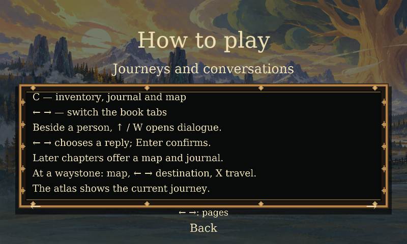
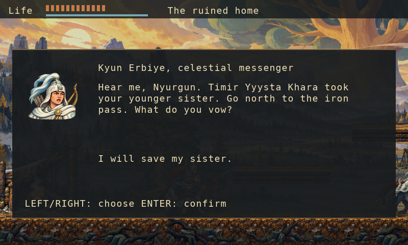
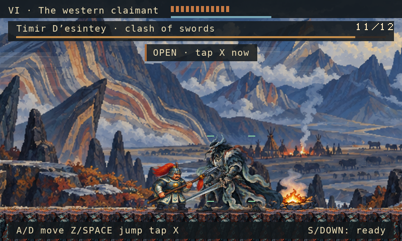

# Nyurgun 0.4.16: a clearer menu, journey book and duel

*15 October 2026 · Local development report*

Nyurgun’s title screen now uses a large serif title and a central timber-and-bronze
menu over the painted Sakha homeland. Continue, New journey, Options, How to play
and Quit have a visible selector. Options changes the actual game language;
Sakha remains the default, with Russian and English available. The lettering
uses the open DejaVu Serif family, with all Sakha letters retained.

The journey book and conversations are easier to find. C opens inventory,
journal and the current route map; Left/Right switches tabs. Later chapters
have their own map and journal. The rescue pause menu also opens those tabs
directly. Beside a character, Up/W opens dialogue, Left/Right selects a reply,
and Enter confirms it. These are maps of the implemented journeys, not an
Olonkho-wide overworld.

Painted terrain now has transparent upper edges instead of an opaque matte.
Its support offsets align the visible material with character soles. Chapter VI’s
duel distinguishes an opening from a reachable hit: its cues account for facing,
weapon contact, the time needed to reach the active pose, and recovery. The
roll cue follows the actual skill, focus and cooldown gates.

*All images above are real Wick/Lantern headless rendering fixtures with seeded
states. They are not native-window captures or proof of a complete playthrough.*

## What we verified

The exact assembled game passes 43 menu/journey checks, 49 saved-title checks,
156 entry checks and 56 duel checks. Another 63 synthetic package tests pass.
A fresh ordinary-input headless campaign reaches VIII in 12,567 frames, with
20 captures and four map roundtrips. Independent review has no open findings.

The local Apple Silicon macOS app passes strict ad-hoc signature verification:
46 app files, 41 resources and 43 source/runtime comparisons are bound to the
recorded inputs. Every file in the previous 0.4.15 app remains unchanged.
Native inspection covered the Sakha title, mouse Options/Back, keyboard help,
Continue into an existing VI save, its inventory/map, and ordinary movement on
painted terrain. Full native boss victory, a full native campaign and measured
frame cadence remain unverified. The app is unnotarized and has not been
released publicly.

Full native gameplay and cadence, the requested Castlevania-level craft,
full 4K presentation, cultural/fluent Sakha review, notarization and the complete
epic remain open. Approved voice and music takes remain at zero. Earlier
0.4.13 and 0.4.15 artifacts and reports are preserved.

## 0.4.17 update: herbs and map navigation

The rescue and Chapter VI inventory now share a herb card showing herb count,
current/max health and X to eat one herb. It shows the actual recovery available,
up to six HP: at 11/12 health, the card shows +1. Full health and an empty pouch
have explicit disabled messages. Healing controllers and saves are unchanged.

From VI's map, Left opens inventory and Right opens journal. From the rescue map,
Down opens inventory and Up opens journal.

The exact local 0.4.17 app passes 47 targeted checks with 33 three-language
captures, 63 packaging tests and strict ad-hoc signature verification. Independent
review has no open findings. Native inspection covered saved VI inventory with
three herbs at 20/20 health, X preserving herbs at full health, and map/back
navigation. Damaged-health eating in native play, a fresh full campaign and
travel execution were not rerun. All 46 files in the 0.4.16 app remain unchanged;
no new art or audio is integrated.
