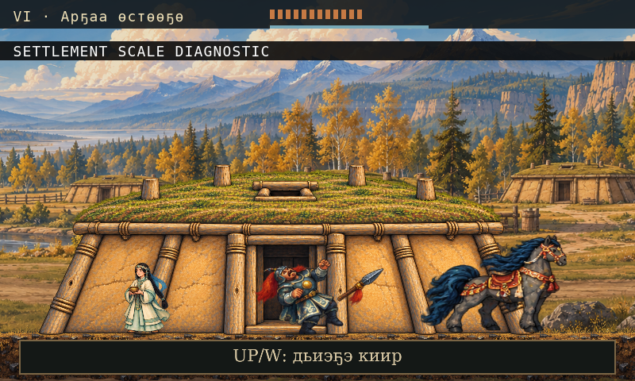
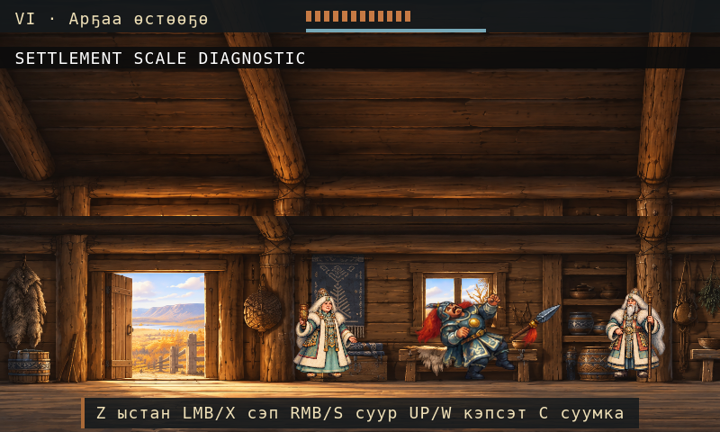
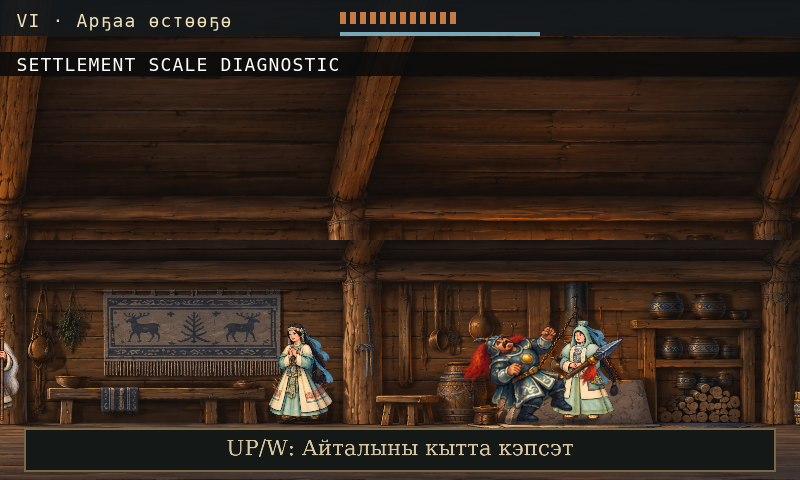

# Nyurgun 0.4.22: a village at human scale and responsive mouse combat

*16 October 2026 · Local development report*

Nyurgun's 0.4.22 repair brings mouse combat and the village's physical scale into
closer agreement with the existing game. Left click attacks like X; right click
uses the earned S/Down swift move. Three timed strikes finish with a stronger hit.
Ward and grapple requirements still govern the story encounters, and the fast
jump, earned double jump, dash/dodge and input assistance are retained.

The house now has a frontal, level base in contact with the soil. Its approximately
56-pixel doorway matches the established 50-pixel hero. The complete painting is
1774×887 pixels and is drawn with a uniform 0.2 scale.

Inside, the floor meets the characters' feet and doors and furniture use a more
consistent human scale. Two complete generated bands form a 3237×972 panorama,
retaining their exact RGB pixels. The visible timber join, rafter alignment and
broad doorway remain qualified. The village background also retains its complete
2290×687 source: 2.8625 source pixels per logical pixel, up from 1.65 but still
below the target of four.

Soft oval shadows replace rectangular contact marks. Tree roots meet supported
soil, and Chapter VI's rear rock shelves explain existing ledges without changing
their collision. A confirmed conversation reply keeps a marker and briefly
outlines the answer. This also makes the first topic acknowledge a click when its
text was already visible.

*These images are actual Wick/Lantern headless scale fixtures. They are not
native-window captures or evidence of a complete native playthrough.*

## What we verified

The final assembly passes 107 primary/combo checks across 207 runs and 8,304 frames.
Fifteen retained-movement cases pass and three deliberate ability-loss mutations
are rejected. Seventeen combat-state cases pass and thirteen mutations are rejected.
All 31 art contracts and 55 scale checks pass. The ordinary-input headless campaign
starts from empty private saves and reaches VIII in 12,602 frames, with twenty
captures and four map roundtrips. Fresh integrated review has no findings.

The first final campaign attempt failed to link its observer after the engine's
mouse-button ABI changed. That failure remains recorded. The repaired test
platforms pass the campaign, audio and performance checks; production game source
was unchanged by that harness fix.

The package record binds 53 app files and 50 source/runtime copies. Its original
strict signature pass is historical: root FinderInfo metadata now blocks that
check on the original app. A local metadata-clean ZIP preserves the exact contents
of all 53 files; its extracted app passes strict ad-hoc signature verification. Native inspection
of the original app covers the title, saved VI Continue,
earned swift by right click, a left-click hit on Timir, jump/hurt and retry/pause.
A separately labeled diagnostic fixture shows the village house at human scale.
Native interior/dialogue checks, three-hit completion, a full native campaign,
measured 60 FPS, final visual/cultural/fluent Sakha approval and
notarization remain unverified. The interior qualifications and village density
shortfall are still open. Approved voice/music takes remain zero: VoiceStudio and
YuE packets are prepared, not generated performances. Chapter IX and the complete
epic are not implemented, and the requested Castlevania-level finish is unfinished.

Earlier apps, the initial 0.4.21 visual candidate, original paintings and failed
candidates remain preserved. These checks establish the local app; source
publication and public build distribution are recorded separately.
